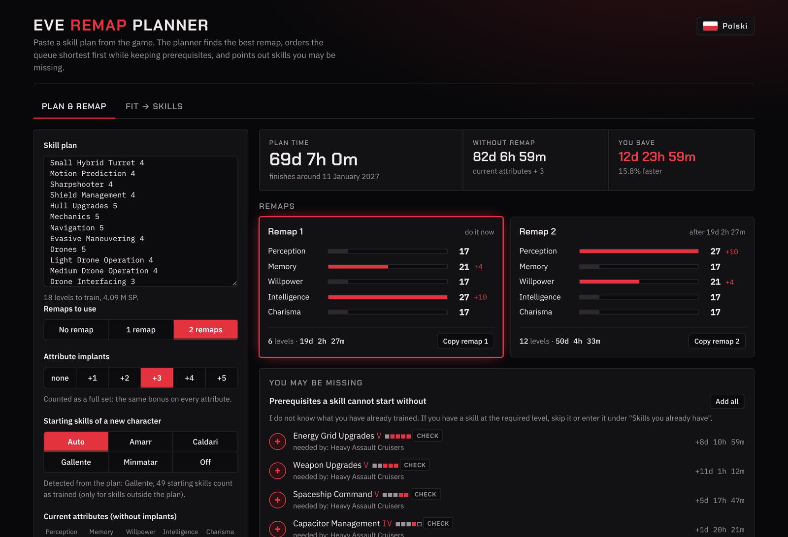
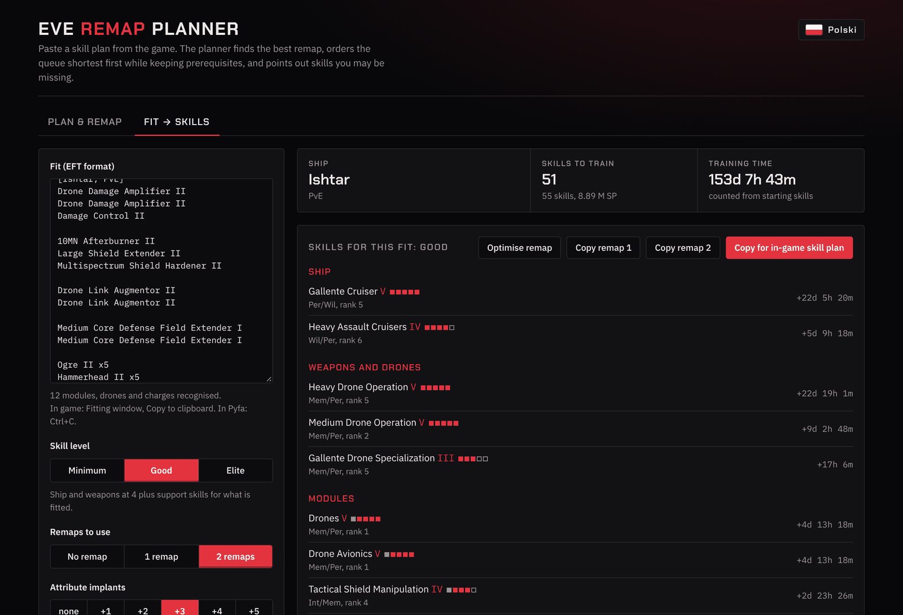

# EVE Remap Planner

[](https://github.com/EasyK0/EveRemapPlanner/actions/workflows/test.yml)
[](https://github.com/EasyK0/EveRemapPlanner/releases)
[](LICENSE)

A skill-plan optimizer for EVE Online. Paste a skill plan or a ship fit and it finds the attribute remap that trains the plan fastest, orders the queue, and catches missing prerequisites. Everything runs in your browser: no server, no account, no tracking.

**[Live demo](https://easyk0.github.io/EveRemapPlanner/)**: open it and paste a plan from the game.



## Features

- **Optimal remap.** Searches every valid attribute distribution (2,885 of them) for 0, 1 or 2 remaps, with +0 to +5 implants.
- **Two-remap split.** Decides which skills go before and after the second remap, without ever training a skill before its prerequisites.
- **Smart queue order.** Shortest skills first, prerequisites always earlier, and Cybernetics first so implants can go in as soon as possible.
- **Missing skills.** Lists prerequisites the plan forgot and suggests support skills (fitting, capacitor, drones and so on), each one click away from the plan.
- **Fit → skills.** Paste an EFT fit (from the game or Pyfa) and get the skills it needs at three levels: *Minimum*, *Good* or *Elite*.
- **Back to the game.** One click copies the result in the in-game skill plan format.
- English and Polish UI. Inputs are kept in `localStorage`.



## How it works

Training speed in EVE is `primary + secondary / 2` SP per minute, so a plan's total time is a sum over skills of `SP / rate(attributes)`.

1. **One remap.** Skills that share an attribute pair and implant bonus are merged, so the cost of each candidate distribution is one pass over a handful of groups. With 2,885 candidates, an exhaustive search is instant and exact.
2. **Two remaps.** This is an alternating optimization. Given two remaps `A` and `B`, each skill gets a weight `time(B) − time(A)`. The best set of skills to train under `A` has to be *closed under prerequisites*: you can't train a skill under remap 1 if its prerequisite waits for remap 2. That is a **maximum-weight closure** problem, solved exactly with a min-cut (Dinic's algorithm). The remaps are then re-fitted to their new skill sets, and the steps repeat until the total stops improving. Several starting pairs are tried.
3. **Ordering.** Within each remap block, a greedy topological sort picks the shortest skill that is ready to train.

Skill data (ranks, attributes, prerequisites for 512 skills and 5,721 item types) comes from CCP's static data export via [`@eveshipfit/sde`](https://www.npmjs.com/package/@eveshipfit/sde).

## Project layout

| Path | Contents |
|---|---|
| `remap-planner.html` | The whole app in one self-contained file: UI, data and engine |
| `engine.js` | The engine on its own, without the DOM: plan parsing, remap search, min-cut, ordering, fit analysis |
| `tests/engine.test.js` | Engine tests using Node's built-in test runner |
| `exe-src/` | Optional Windows wrapper in Go: embeds the page, serves it on `127.0.0.1` and opens it as an Edge/Chrome app window |

## Running

- **Browser:** open `remap-planner.html`, or use the [live demo](https://easyk0.github.io/EveRemapPlanner/).
- **Windows app:** download `EveRemapPlanner.exe` from [Releases](https://github.com/EasyK0/EveRemapPlanner/releases), or build it:

  ```sh
  cd exe-src
  cp ../remap-planner.html .
  go install github.com/tc-hib/go-winres@v0.3.3
  go-winres make --arch amd64
  GOOS=windows GOARCH=amd64 CGO_ENABLED=0 go build -trimpath -ldflags "-H windowsgui -s -w" -o EveRemapPlanner.exe .
  ```

  The wrapper only answers requests addressed to `127.0.0.1:47321`, which blocks DNS-rebinding attacks. It exits when the window closes.

## Tests

Requires Node.js 20 or newer. No packages are needed.

```sh
node --test tests/engine.test.js
```

The page carries its own copy of the engine, so after changing `engine.js`, copy it into `remap-planner.html` too. A test fails if the two differ.

## License

[MIT](LICENSE). EVE Online and all related data are the property of CCP hf. This project is not affiliated with or endorsed by CCP.
